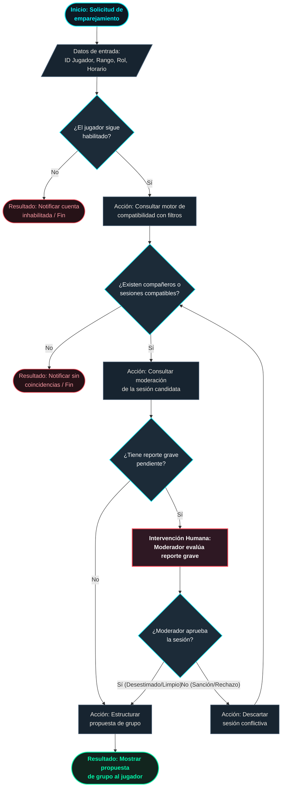
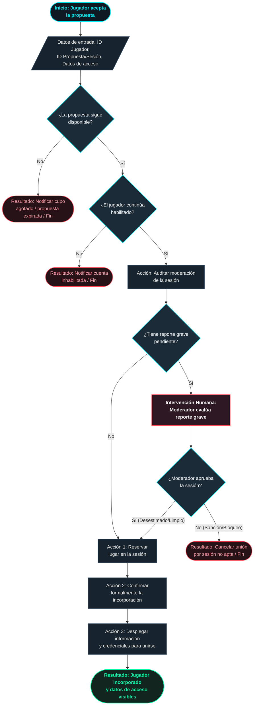

# ValoVibes_by_CodeHeroes

> 🌐 **Deploy oficial:** [https://valovibes.vercel.app/](https://valovibes.vercel.app/)

Landing page del TP3 de la materia Desarrollo de Sistemas Web (Front End) - IFTS29

## Consigna Asignada por el Docente

**ASIGNACIÓN DOCENTE · SORTEO · S12-B**  
**ValoVibes**  
**Videojuegos y comunidades**  

### Objetivo de la startup
Búsqueda de compañeros de Valorant compatibles y coordinación de invitaciones.

### Bloque: Invitaciones

#### FRASE 1 · R3
Si un jugador sigue habilitado y hay compañeros compatibles con su rango, rol y horario en una sesión sin revisión por reporte grave pendiente, el sistema le muestra una propuesta de grupo.

#### FRASE 2 · R4
Si el jugador acepta una propuesta que sigue disponible, continúa habilitado y la sesión no tiene una revisión por reporte grave pendiente, el sistema reserva su lugar, confirma su incorporación y muestra la información para unirse.

---

## Fichas de Análisis

### Ficha de análisis: Frase 1 (R3)

* **Sentencia original:** «Si un jugador sigue habilitado y hay compañeros compatibles con su rango, rol y horario en una sesión sin revisión por reporte grave pendiente, el sistema le muestra una propuesta de grupo.»
* **Datos necesarios:**
  * Estado de habilitación del jugador (si sigue habilitado / sin sanciones activas).
  * Filtros de compatibilidad del jugador: rango, rol y horario.
  * Listado de sesiones disponibles y activas.
  * Estado de revisión de cada sesión (verificar que no tenga un reporte grave pendiente).
* **Condición:**
  * Se deben cumplir simultáneamente cuatro condiciones lógicas:
    1. El jugador está habilitado.
    2. Existen compañeros o sesiones compatibles según rango, rol y horario.
    3. La sesión evaluada está activa.
    4. La sesión no tiene un reporte grave pendiente de revisión.
* **Consecuencia:**
  * El sistema muestra formalmente la propuesta de grupo al jugador.

### Ficha de análisis: Frase 2 (R4)

* **Sentencia original:** «Si el jugador acepta una propuesta que sigue disponible, continúa habilitado y la sesión no tiene una revisión por reporte grave pendiente, el sistema reserva su lugar, confirma su incorporación y muestra la información para unirse.»
* **Datos necesarios:**
  * Confirmación de aceptación del jugador sobre la propuesta de grupo.
  * Estado de disponibilidad de la propuesta / cupo en la sesión.
  * Estado de habilitación actual del jugador (que continúe habilitado / sin sanciones).
  * Estado de moderación de la sesión (verificar que no tenga un reporte grave pendiente de revisión).
  * Datos de acceso de la sesión (código de sala, lobby, canal de voz o enlace para unirse).
* **Condición:**
  * Se deben cumplir simultáneamente cuatro condiciones lógicas:
    1. El jugador acepta la propuesta.
    2. La propuesta sigue disponible (tiene lugar libre y vigencia).
    3. El jugador continúa habilitado.
    4. La sesión no tiene una revisión por reporte grave pendiente.
* **Consecuencia:**
  * El sistema ejecuta tres acciones consecutivas:
    1. Reserva su lugar en la sesión.
    2. Confirma formalmente su incorporación.
    3. Muestra la información necesaria para que pueda unirse.

---

## Propuestas de Flujo para Agentes IA

### Propuesta de Flujo para Frase 1 (R3): Agente de Emparejamiento y Generación de Propuestas de Escuadra

* **Beneficio:** Automatiza la búsqueda inteligente de compañeros afines reduciendo drásticamente los tiempos de espera y la frustración del emparejamiento aleatorio. Asegura que solo se sugieran grupos que respeten las normas de convivencia y el nivel de habilidad del jugador. Fomenta sesiones de juego más equilibradas, colaborativas y duraderas dentro de la comunidad de Valorant.
* **Qué tendría que hacer el agente IA (flujo de acciones):**
  1. Verificar el estado de habilitación de la cuenta del jugador solicitante.
  2. Extraer y evaluar los parámetros de búsqueda del jugador: rango competitivo, rol predilecto y franja horaria.
  3. Buscar sesiones activas con cupos disponibles que coincidan con dichos criterios de compatibilidad.
  4. Auditar el estado de moderación de cada sesión candidata para comprobar que no existan reportes graves pendientes de resolución.
  5. Formatear y presentar la propuesta de grupo personalizada en la interfaz del jugador.
* **Para qué serviría:** Para filtrar, validar y conectar de manera proactiva a jugadores compatibles en entornos seguros sin requerir búsquedas manuales por parte del usuario.
* **Qué resultado produciría:** Una propuesta de grupo estructurada (notificación interactiva con detalles de la sesión, miembros, roles y horarios) desplegada en la pantalla del jugador.
* **Herramientas o intervención humana:**
  * **Herramientas a consultar:** API o base de datos de usuarios (estado de cuenta), motor de emparejamiento/búsqueda de sesiones y base de datos del sistema de moderación y reportes.
  * **Intervención de una persona:** Requeriría la intervención de un moderador humano únicamente si una sesión potencialmente compatible se encuentra retenida debido a un reporte grave pendiente de resolución manual.
* **Diagrama de Flujo del Agente:**

---

### Propuesta de Flujo para Frase 2 (R4): Agente de Confirmación, Reserva e Incorporación a la Sesión

* **Beneficio:** Garantiza una transición inmediata y segura desde la aceptación de la invitación hasta el ingreso efectivo a la partida. Evita conflictos por cupos duplicados y asegura que las condiciones de seguridad y habilitación se mantengan vigentes en el instante exacto de la confirmación. Proporciona al jugador toda la información técnica y de acceso sin demoras ni pasos manuales extra.
* **Qué tendría que hacer el agente IA (flujo de acciones):**
  1. Capturar el evento de aceptación de la propuesta por parte del jugador.
  2. Verificar en tiempo real la disponibilidad y el cupo libre de la sesión seleccionada.
  3. Revalidar que el jugador continúe en estado habilitado en el momento exacto de la confirmación.
  4. Revalidar que la sesión destino mantenga su estado libre de revisiones por reportes graves pendientes.
  5. Ejecutar la reserva atómica del cupo para el jugador en la sesión.
  6. Emitir la confirmación formal de incorporación al grupo.
  7. Obtener y desplegar la información y credenciales de acceso (código de sala, lobby o canal de voz) para el jugador.
* **Para qué serviría:** Para formalizar la admisión del jugador al equipo de forma atómica y consistente, resguardando la integridad del grupo y agilizando su ingreso al juego.
* **Qué resultado produciría:** Un lugar reservado y confirmado en la sesión, la actualización del estado del grupo a nivel de sistema, y la entrega de los datos de acceso directo en la interfaz del usuario.
* **Herramientas o intervención humana:**
  * **Herramientas a consultar:** Servicio de gestión de sesiones/reservas (para bloqueo y asignación de cupos), servicio de autenticación y estado de usuario, servicio de auditoría/reportes y servicio de credenciales de sala (API de lobby/chat/voz).
  * **Intervención de una persona:** Podría requerirse intervención de una persona (soporte técnico o moderador) únicamente de manera excepcional ante incidencias de colisión de cupos o bloqueos preventivos de última hora por reportes.
* **Diagrama de Flujo del Agente:**

